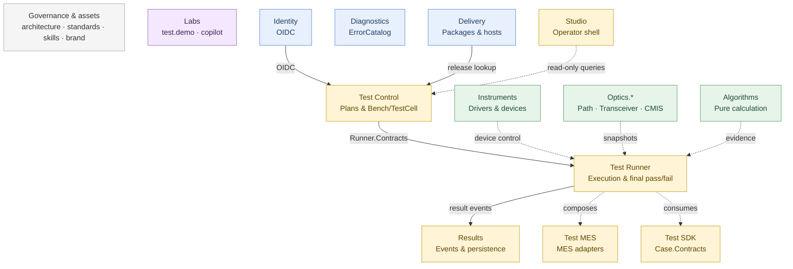

  

# OpenTest

OpenTest is a modular ecosystem for laboratory optical-module testing. Its repositories deliberately separate reusable business services, identity and authorization, diagnostics, package and deployment delivery, instrument integration, optical-path design, read-only transceiver interpretation and its CMIS read/write access package, a CMIS desktop analyzer, deterministic measurement algorithms, the frozen test-case contract SDK, the results domain and its event contracts, the server-side test control plane, the on-bench test runner, the operator shell, and MES integration adapters, around governance, standards, skills, and brand assets.

It is not a monorepo. Each project owns its source code, releases, architecture decisions, risks, and detailed design documents. Identity, control, delivery, diagnostics, execution, and results are owned by focused services.

## Ecosystem architecture

The diagram is standard Mermaid, rendered directly by GitHub from this README.
The repository tables below remain the authoritative list of current
responsibilities.

Governance and Labs are context groups; the arrows show the runtime contract flow. They express integration through published packages and stable contracts, not source-code coupling. Domain projects publish focused capabilities. The Test Control plane owns test plans, recipes, Bench/TestCell configuration, admission, and run summaries, and references Delivery releases instead of duplicating package lifecycle. Delivery owns package registration, immutable releases, artifact content, managed hosts, and deployment batches. The Runner owns on-bench execution: it consumes versioned bench snapshots offline-first, resolves the package from Delivery, replays run results through a file outbox, and writes results into the Results domain. Studio composes Control, Delivery, Diagnostics, Results, and Identity through their application contracts and HTTP APIs. Final pass/fail sequencing remains with the Runner.

## Repositories

### Domain and platform

| Repository | Responsibility | Deliberate boundary |
| --- | --- | --- |
| [OpenTest.Identity](https://github.com/OpenTest-Labs/opentest.identity) | Independently deployed ABP identity and authorization service: users, roles, permissions, OpenID Connect, and account administration. | It owns authentication and authorization data; it does not own test-control, bench, instrument, delivery, or test-execution data. |
| [OpenTest.Diagnostics](https://github.com/OpenTest-Labs/opentest.diagnostics) | Independent diagnostics services, currently ErrorCatalog definitions, resolution rules, publications, snapshots, and candidate governance. | It owns diagnostics data and APIs; Studio hosts the user experience, while Control and Runner consume its contracts or snapshots. |
| [OpenTest.Delivery](https://github.com/OpenTest-Labs/opentest.delivery) | Package registration and immutable releases, artifact content and SHA-256 integrity, API snapshots, package documentation intelligence, managed hosts and Agent heartbeats, deployment batches, target results, and rollback facts. | It owns package, artifact, and host lifecycle; Control keeps only a Delivery release reference and does not copy those aggregates. |
| [OpenTest.Instruments](https://github.com/OpenTest-Labs/opentest.instruments) | Instrument contracts, Windows-capable drivers, and shared-lab instrument hosting. | It does not own product test logic or measurement-result interpretation. |
| [OpenTest.Optics.Path](https://github.com/OpenTest-Labs/opentest.optics.path) | Versioned optical topology contracts, route validation, path plans, and the offline designer. | It does not bind logical paths to physical drivers or perform calibrated measurements. |
| [OpenTest.Optics.Transceiver](https://github.com/OpenTest-Labs/opentest.optics.transceiver) | Standards-oriented, transport-independent interpretation of pluggable transceiver module memory (SFF-8472 and CMIS): identity, monitoring, thresholds, alarms, applications, and datapaths as immutable read-only snapshots with stable diagnostics. It also publishes the `OpenTest.Optics.Transceiver.Cmis` read/write access package used by host tools. | It does not own physical I2C/USB adapters, the desktop shell, instrument sessions, firmware, product limits, or final pass/fail. |
| [OpenTest Optics CMIS Analyzer](https://github.com/OpenTest-Labs/opentest.optics.cmis) | Windows desktop tool for CMIS 5.2/5.3 optical modules: register and CDB editing, monitoring, VDM diagnostics, read-only snapshots, and the transparent-serial, IICHIB/CH347, and simulated I2C adapters. | It does not own CMIS protocol semantics or decoding, which come from the `OpenTest.Optics.Transceiver.Cmis` package. |
| [OpenTest.Algorithms](https://github.com/OpenTest-Labs/opentest.algorithms) | Pure, reproducible calculations, fitting, evidence, and diagnostics for completed measurement data. | It does not acquire data, parse device exports, control instruments, or decide product pass/fail. |
| [OpenTest.Test.Sdk](https://github.com/OpenTest-Labs/opentest.test.sdk) | Source of truth for the single public contract package `OpenTest.Test.Case.Contracts` (1.0.0) shared by test cases and hosts, with an enforced API lock and migration documentation. | It publishes contracts only: no engine implementation, runtime, persistence, or drivers. |
| [OpenTest.Test.Results](https://github.com/OpenTest-Labs/opentest.test.results) | Single owner of the Results domain: the `schemaVersion = 2` event envelope, serializer, JCS hashing, validation, the reviewed API lock, ingestion, query, Excel export, EF Core persistence, migrations, CLI, and golden fixtures. Publishes `OpenTest.Test.Results.Contracts` and the Results application contracts. | It owns the result domain, wire contract, and persistence; it does not execute tests, drive instruments, or decide product pass/fail. |
| [OpenTest.Test.Control](https://github.com/OpenTest-Labs/opentest.test.control) | Independently deployed ABP Web test control plane: test plans and product applicability, immutable TestRecipe releases, Bench/TestCell configuration, admission, run summaries, and Delivery release references. It serves versioned bench snapshots and run-writeback endpoints to the Runner and authenticates through the standalone Identity service. | It is a greenfield control plane: it does not import old platform data, does not store measurement values, does not own package or host lifecycle, and does not execute tests or drive instruments. |
| [OpenTest.Test.Runner](https://github.com/OpenTest-Labs/opentest.test.runner) | WPF-first runner on the bench PC: standalone Identity login, permission-driven navigation, offline-first bench-snapshot cache with a file outbox, run creation and writeback through the Test Control API, the `Runner.Packages` test-case package loader, and result spooling into the Results domain. | It does not own management, configuration, or deployment data, has no direct management database access, and defers all configuration writes to the Test Control API. |
| [OpenTest.Test.Studio](https://github.com/OpenTest-Labs/opentest.test.studio) | Unified operator shell: navigation, composition, authentication integration, and read-only remote clients for Control, Delivery, Diagnostics, Results, and Identity. | It is database-free and owns no other domain's entities or schemas; it does not host Control, Delivery, or Results databases. |
| [OpenTest.Test.Mes](https://github.com/OpenTest-Labs/opentest.test.mes) | MES integration adapters: a vendor-neutral `IMesGateway`, an abstract local MES (state machine, gate/sampling rules, offline ledger), and SDK bridges to `IProductionControlService`, `IQualityGateService`, `ISamplingControlService`, and `ITestDataService`. | It does not own parameter history, test execution, final product disposition, or vendor protocol implementations. |

### Governance, knowledge, and assets

| Repository | Responsibility | Deliberate boundary |
| --- | --- | --- |
| [opentest.architecture](https://github.com/OpenTest-Labs/opentest.architecture) | Organization-level architecture repository: ecosystem boundaries, per-project current-architecture baselines, cross-project engineering rules, and the testing-domain delivery roadmap. | It records decisions that span repositories; it does not duplicate a project's implementation design, backlog, or release notes. |
| [opentest.standards](https://github.com/OpenTest-Labs/opentest.standards) | Versioned source of truth for shared development standards (migrated 2026-10-23 from `xin-pu/dev-standards`), including the workspace ADRs on repository naming, package identity, and the test-case SDK. Each maintained repository pins the revision it adopts. | Project-specific exceptions are auditable in each repository's own ledger, not here. |
| [opentest.brand](https://github.com/OpenTest-Labs/opentest.brand) | OpenTest brand assets: locked glyph, production size sets, application icons, and usage guidance. | It does not replace project-level architecture or implementation documentation. |
| [opentest.skills](https://github.com/OpenTest-Labs/opentest.skills) | Reusable OpenTest development skills: test-case authoring, contract maintenance with the API baseline, and demo coverage extension. | It is guidance for developers and agents, not an application runtime dependency. |

### Labs

| Repository | Responsibility | Deliberate boundary |
| --- | --- | --- |
| [opentest.test.demo](https://github.com/OpenTest-Labs/opentest.test.demo) | Executable, readable examples for every public surface of `OpenTest.Test.Case.Contracts`, organized one test case per file with a hand-written fake harness and a generated coverage map. | It runs without a runner, host, instrument, or database; it is not a build or runtime dependency of any project. |
| [opentest.copilot](https://github.com/OpenTest-Labs/opentest.copilot) | Experimental conversational desktop device runner: an LLM drives Instruments through function calling with confirmation cards and full auditing, and approved operations crystallize into editable, deterministically replayable JSON flows. | It is a labs experiment consuming published packages; it does not change the driver stack. |

## Tooling direction

Small, single-purpose developer and desktop tools normally live with the domain they explain or validate. Cross-domain orchestration, integrated regression, and system-level validation belong to the test platform pair: Test Control for plan and configuration authority, Test Runner for on-bench execution and final decisions. Delivery carries the package and deployment lifecycle that the pair consumes. The current sequence — record parity, delivery pipeline, Runner execution closure, MES implementation, and governance completion — is tracked in the [testing-domain delivery roadmap](https://github.com/OpenTest-Labs/opentest.architecture) in `opentest.architecture`.

| Project | Planned focused tooling |
| --- | --- |
| OpenTest.Algorithms | A scriptable algorithm CLI, a result-explanation workbench, and golden-fixture/method-version difference review. |
| OpenTest.Optics.Transceiver | A developer fixture tool that imports sanitized CMIS-DUMP memory images, and (later) a read-only snapshot inspection harness. |
| OpenTest.Test.Results | Results CLI operations, ingestion diagnostics, performance baselines, and export tooling. |
| OpenTest.Delivery | Package documentation inspection, artifact integrity checks, and deployment dry-run/rollout tooling. |
| OpenTest.Test.Runner | Test-case package loading, execution kernel, on-bench sequencing, and final pass/fail authority for bench execution. |
| OpenTest.Test.Control | Test plans, immutable recipe releases, Delivery release references, Bench/TestCell configuration, admission, and run summaries. |
| OpenTest.Test.Studio | Navigation and read-only composition of Control, Delivery, Diagnostics, Results, and Identity. |

These are planning directions, not released components. Their detailed scope, implementation decisions, and acceptance criteria are recorded in the relevant project repository when work is approved.

## Documentation and governance

- Durable, project-specific decisions belong in that repository's `docs/design/`, `docs/adr/`, and `docs/ledger/` records.
- Decisions that affect more than one repository belong in [opentest.architecture](https://github.com/OpenTest-Labs/opentest.architecture).
- Shared engineering rules live in the versioned [opentest.standards](https://github.com/OpenTest-Labs/opentest.standards) knowledge base; each maintained repository pins its adopted revision in `docs/standards-reference.md` and records any approved project-specific deviation in its ledger.
- A cross-project capability should depend on published contracts or stable interfaces, not another repository's internal implementation details.
- Workspace layout and repository naming follow `opentest.standards` ADR-0001; published package identity rules follow ADR-0002 and ADR-0003.

## Brand

The OpenTest glyph is locked: do not alter its shapes, proportions, or red status dot. Production assets and usage guidance live in [opentest.brand](https://github.com/OpenTest-Labs/opentest.brand).
