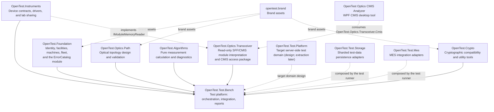

  

# OpenTest

OpenTest is a modular ecosystem for laboratory optical-module testing. Its repositories deliberately separate reusable business services, instrument integration, optical-path design, read-only transceiver interpretation, deterministic measurement algorithms, cryptographic utilities, sharded test-data persistence, MES integration, the assembled test platform, and shared visual assets.

It is not a monorepo. Each project owns its source code, releases, architecture decisions, risks, and detailed design documents.

## Ecosystem map

The arrows express integration through published packages and stable contracts, not source-code coupling. Domain projects publish focused capabilities; TestBench owns test sequencing, product rules, final pass/fail decisions, reporting, and integration verification. The storage and MES adapters are composed by the test runner through the frozen `OpenTest.Test.Case.Contracts` package; they are infrastructure behind the host, not TestBench decision owners.

## Repositories

| Repository | Responsibility | Deliberate boundary |
| --- | --- | --- |
| [OpenTest.Foundation](https://github.com/OpenTest-Labs/opentest.foundation) | Identity, facilities, machine management, fleet management, and reusable platform services. It also hosts the ErrorCatalog business module. | It does not own instrument protocols, optical calculations, or test execution. |
| [OpenTest.Instruments](https://github.com/OpenTest-Labs/opentest.instruments) | Instrument contracts, Windows-capable drivers, and shared-lab instrument hosting. | It does not own product test logic or measurement-result interpretation. |
| [OpenTest.Optics.Path](https://github.com/OpenTest-Labs/opentest.optics.path) | Versioned optical topology contracts, route validation, path plans, and the offline designer. | It does not bind logical paths to physical drivers or perform calibrated measurements. |
| [OpenTest.Optics.Transceiver](https://github.com/OpenTest-Labs/opentest.optics.transceiver) | Standards-oriented, transport-independent interpretation of pluggable transceiver module memory (SFF-8472 and CMIS): identity, monitoring, thresholds, alarms, applications, and datapaths as immutable read-only snapshots with stable diagnostics. It also publishes the `OpenTest.Optics.Transceiver.Cmis` read/write access package used by host tools. | It does not own physical I2C/USB adapters, the desktop shell, instrument sessions, firmware, product limits, or final pass/fail. |
| [OpenTest Optics CMIS Analyzer](https://github.com/OpenTest-Labs/opentest.optics.cmis) | Windows desktop tool for CMIS 5.2/5.3 optical modules: register and CDB editing, monitoring, VDM diagnostics, read-only snapshots, and the transparent-serial, IICHIB/CH347, and simulated I2C adapters. | It does not own CMIS protocol semantics or decoding, which come from the `OpenTest.Optics.Transceiver.Cmis` package. |
| [OpenTest.Algorithms](https://github.com/OpenTest-Labs/opentest.algorithms) | Pure, reproducible calculations, fitting, evidence, and diagnostics for completed measurement data. | It does not acquire data, parse device exports, control instruments, or decide product pass/fail. |
| [OpenTest.Crypto](https://github.com/OpenTest-Labs/opentest.crypto) | Cryptographic compatibility helpers and narrowly scoped cryptographic utilities. | It does not own licensing, remote KMS/HSM, or organization-wide key governance. |
| [OpenTest.Test.Bench](https://github.com/OpenTest-Labs/opentest.test.bench) | The assembled test platform: plugin-based test orchestration, MES and system integration, the test framework, and reporting over the other projects. | It does not own the domain capabilities it composes, nor instrument protocols or measurement algorithms. |
| [OpenTest.Test.Platform](https://github.com/OpenTest-Labs/opentest.test.platform) | Target design for the server-side test-platform domain: test schemes and product applicability, versioned plan releases, test-case package dependencies, Bench/Resource configuration, MES/simulated context, and run summaries. | It is not a current build or runtime dependency; live execution and device drivers stay in `opentest.test.bench`, and in-place modernization precedes any extraction. |
| [OpenTest.Test.Storage](https://github.com/OpenTest-Labs/opentest.test.storage) | Test-data persistence adapters: family database × yearly file × month-rolled large tables behind a pluggable engine seam, `payload_json` extension discipline, blob lifecycle, retention and archival, and the Auto/External/BuiltIn/Dual composition. | It does not own test execution, product pass/fail, MES semantics, or vendor protocols. |
| [OpenTest.Test.Mes](https://github.com/OpenTest-Labs/opentest.test.mes) | MES integration adapters: a vendor-neutral `IMesGateway`, an abstract local MES (state machine, gate/sampling rules, offline ledger), and SDK bridges to `IProductionControlService`, `IQualityGateService`, `ISamplingControlService`, and `ITestDataService`. | It does not own parameter history, test execution, final product disposition, or vendor protocol implementations. |
| [opentest.brand](https://github.com/OpenTest-Labs/opentest.brand) | OpenTest brand assets. | It does not replace project-level architecture or implementation documentation. |
| `opentest.skills` | Reserved repository for OpenTest-specific reusable skills and workflow assets. It has no published content yet. | It is not an application runtime dependency. |
| `opentest.test.sample` | Reserved demonstration repository for an example published TestCase package. Scaffolded with a license and ignore rules only; it has no published content yet. | It is not a build or runtime dependency of any project. |

> ErrorCatalog is no longer a standalone repository. It is composed into `opentest.foundation` as the `modules/error-catalog/` business module, per Foundation ADR-0010. Its consumer contracts are published independently as `OpenTest.ErrorCatalog.Contracts`, the renamed successor of the retired `OpenTest.ErrorCodes.Contracts` package.

## Tooling direction

Small, single-purpose developer and desktop tools normally live with the domain they explain or validate. Cross-domain orchestration, integrated regression, and system-level validation belong to TestBench, which assembles the other projects.

| Project | Planned focused tooling |
| --- | --- |
| OpenTest.Algorithms | A scriptable algorithm CLI, a result-explanation workbench, and golden-fixture/method-version difference review. |
| OpenTest.Optics.Transceiver | A developer fixture tool that imports sanitized CMIS-DUMP memory images, and (later) a read-only snapshot inspection harness. |
| OpenTest.Crypto | A crypto CLI, ciphertext inspection and controlled migration, and lightweight local key use with a clear boundary from remote key governance. |
| OpenTest.Test.Bench | Test orchestration, integrated regression, test reporting, product rules, and final pass/fail authority. |

These are planning directions, not released components. Their detailed scope, implementation decisions, and acceptance criteria are recorded in the relevant project repository when work is approved.

## Documentation and governance

- Durable, project-specific decisions belong in that repository's `docs/design/`, `docs/adr/`, and `docs/ledger/` records.
- Shared engineering rules remain in the versioned [`dev-standards`](https://github.com/xin-pu/dev-standards) knowledge base; each maintained repository records its adopted revision and any approved project-specific deviations.
- A cross-project capability should depend on published contracts or stable interfaces, not another repository's internal implementation details.

## Brand

The OpenTest glyph is locked: do not alter its shapes, proportions, or red status dot. Production assets and usage guidance live in [opentest.brand](https://github.com/OpenTest-Labs/opentest.brand).
