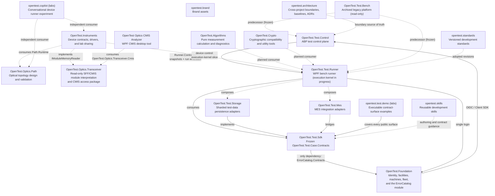

  

# OpenTest

OpenTest is a modular ecosystem for laboratory optical-module testing. Its repositories deliberately separate reusable business services, instrument integration, optical-path design, read-only transceiver interpretation and its CMIS read/write access package, a CMIS desktop analyzer, deterministic measurement algorithms, cryptographic utilities, the frozen test-case contract SDK, the server-side test control plane, the on-bench test runner, sharded test-data persistence, and MES integration adapters, around governance, standards, skills, and brand assets.

It is not a monorepo. Each project owns its source code, releases, architecture decisions, risks, and detailed design documents. The legacy Test Bench is archived: `opentest.test.control` (management plane) and `opentest.test.runner` (bench execution) are its successors.

## Ecosystem map

The arrows express integration through published packages and stable contracts, not source-code coupling. Domain projects publish focused capabilities. The Test Control plane owns test schemes, plan releases, test-case package registration, Bench/Resource configuration, admission, and run summaries. The Runner owns on-bench execution: it consumes versioned bench snapshots offline-first, replays run results through a file outbox, and its execution kernel plus `Runner.Packages` loader are the current delivery slice. The storage and MES adapters are composed by the runner through the frozen `OpenTest.Test.Case.Contracts` package; they are infrastructure behind the host, not decision owners. Final pass/fail sequencing that once belonged to TestBench moves to the Runner as its execution kernel lands.

## Repositories

### Domain and platform

| Repository | Responsibility | Deliberate boundary |
| --- | --- | --- |
| [OpenTest.Foundation](https://github.com/OpenTest-Labs/opentest.foundation) | Identity, facilities, machine management, fleet management, and reusable platform services. It also hosts the ErrorCatalog business module. | It does not own instrument protocols, optical calculations, or test execution. |
| [OpenTest.Instruments](https://github.com/OpenTest-Labs/opentest.instruments) | Instrument contracts, Windows-capable drivers, and shared-lab instrument hosting. | It does not own product test logic or measurement-result interpretation. |
| [OpenTest.Optics.Path](https://github.com/OpenTest-Labs/opentest.optics.path) | Versioned optical topology contracts, route validation, path plans, and the offline designer. | It does not bind logical paths to physical drivers or perform calibrated measurements. |
| [OpenTest.Optics.Transceiver](https://github.com/OpenTest-Labs/opentest.optics.transceiver) | Standards-oriented, transport-independent interpretation of pluggable transceiver module memory (SFF-8472 and CMIS): identity, monitoring, thresholds, alarms, applications, and datapaths as immutable read-only snapshots with stable diagnostics. It also publishes the `OpenTest.Optics.Transceiver.Cmis` read/write access package used by host tools. | It does not own physical I2C/USB adapters, the desktop shell, instrument sessions, firmware, product limits, or final pass/fail. |
| [OpenTest Optics CMIS Analyzer](https://github.com/OpenTest-Labs/opentest.optics.cmis) | Windows desktop tool for CMIS 5.2/5.3 optical modules: register and CDB editing, monitoring, VDM diagnostics, read-only snapshots, and the transparent-serial, IICHIB/CH347, and simulated I2C adapters. | It does not own CMIS protocol semantics or decoding, which come from the `OpenTest.Optics.Transceiver.Cmis` package. |
| [OpenTest.Algorithms](https://github.com/OpenTest-Labs/opentest.algorithms) | Pure, reproducible calculations, fitting, evidence, and diagnostics for completed measurement data. | It does not acquire data, parse device exports, control instruments, or decide product pass/fail. |
| [OpenTest.Crypto](https://github.com/OpenTest-Labs/opentest.crypto) | Cryptographic compatibility helpers, a key-agnostic WPF desktop tool, and narrowly scoped cryptographic utilities. | It does not own licensing, remote KMS/HSM, or organization-wide key governance. |
| [OpenTest.Test.Sdk](https://github.com/OpenTest-Labs/opentest.test.sdk) | Source of truth for the single public contract package `OpenTest.Test.Case.Contracts` (1.0.0) shared by test cases and hosts, with an enforced API lock and migration documentation. | It publishes contracts only: no engine implementation, runtime, persistence, or drivers. The frozen legacy `OpenTest.Test.Bench.Shared` / `TestCase.Contracts` 1.0.1 packages are not produced here. |
| [OpenTest.Test.Control](https://github.com/OpenTest-Labs/opentest.test.control) | Independently deployed ABP Web test control plane: test schemes and product applicability, versioned plan releases, test-case package registration, Bench/Resource configuration, admission, and run summaries. It serves versioned bench snapshots and run-writeback endpoints to the Runner and authenticates through Foundation. Renamed in place from `opentest.test.platform`. | It is a greenfield control plane: it does not migrate legacy Bench tables or old data, does not store measurement values, and does not execute tests or drive instruments. |
| [OpenTest.Test.Runner](https://github.com/OpenTest-Labs/opentest.test.runner) | WPF-first runner on the bench PC: single Foundation login, permission-driven navigation, offline-first bench-snapshot cache with a file outbox, run creation and writeback through the Test Control API, and the `Runner.Packages` test-case package loader. The execution kernel is the current slice. | It does not own management or configuration data, has no direct database access, and defers all configuration writes to the Test Control API. |
| [OpenTest.Test.Storage](https://github.com/OpenTest-Labs/opentest.test.storage) | Test-data persistence adapters: family database × yearly file × month-rolled large tables behind a pluggable engine seam, `payload_json` extension discipline, blob lifecycle, retention and archival, and the Auto/External/BuiltIn/Dual composition. | It does not own test execution, product pass/fail, MES semantics, or vendor protocols. |
| [OpenTest.Test.Mes](https://github.com/OpenTest-Labs/opentest.test.mes) | MES integration adapters: a vendor-neutral `IMesGateway`, an abstract local MES (state machine, gate/sampling rules, offline ledger), and SDK bridges to `IProductionControlService`, `IQualityGateService`, `ISamplingControlService`, and `ITestDataService`. | It does not own parameter history, test execution, final product disposition, or vendor protocol implementations. |
| [OpenTest.Test.Bench](https://github.com/OpenTest-Labs/opentest.test.bench) | Read-only archive of the legacy plugin-based test platform. It remains as the migration reference and the frozen consumer of the retired 1.0.1 packages. | No longer maintained; new development happens in Test Control, Test Runner, and Test SDK. |

### Governance, knowledge, and assets

| Repository | Responsibility | Deliberate boundary |
| --- | --- | --- |
| [opentest.architecture](https://github.com/OpenTest-Labs/opentest.architecture) | Organization-level architecture archive: ecosystem boundaries, per-project current-architecture baselines, cross-project engineering rules, and the testing-domain delivery roadmap. | It records decisions that span repositories; it does not duplicate a project's implementation design, backlog, or release notes. |
| [opentest.standards](https://github.com/OpenTest-Labs/opentest.standards) | Versioned source of truth for shared development standards (migrated 2026-10-23 from `xin-pu/dev-standards`), including the workspace ADRs on repository naming, package identity, and the test-case SDK. Each maintained repository pins the revision it adopts. | Project-specific exceptions are auditable in each repository's own ledger, not here. |
| [opentest.brand](https://github.com/OpenTest-Labs/opentest.brand) | OpenTest brand assets: locked glyph, production size sets, application icons, and usage guidance. | It does not replace project-level architecture or implementation documentation. |
| [opentest.skills](https://github.com/OpenTest-Labs/opentest.skills) | Reusable OpenTest development skills: test-case authoring, contract maintenance with the API baseline, and demo coverage extension. | It is guidance for developers and agents, not an application runtime dependency. |

### Labs

| Repository | Responsibility | Deliberate boundary |
| --- | --- | --- |
| [opentest.test.demo](https://github.com/OpenTest-Labs/opentest.test.demo) | Executable, readable examples for every public surface of `OpenTest.Test.Case.Contracts`, organized one test case per file with a hand-written fake harness and a generated coverage map. | It runs without a runner, host, instrument, or database; it is not a build or runtime dependency of any project. |
| [opentest.copilot](https://github.com/OpenTest-Labs/opentest.copilot) | Experimental conversational desktop device runner: an LLM drives Instruments through function calling with confirmation cards and full auditing, and approved operations crystallize into editable, deterministically replayable JSON flows. | It is a labs experiment consuming published packages; it does not change the driver stack. |

> ErrorCatalog is no longer a standalone repository. It is composed into `opentest.foundation` as the `modules/error-catalog/` business module, per Foundation ADR-0010. Its consumer contracts are published independently as `OpenTest.ErrorCatalog.Contracts` (1.2.0), the renamed successor of the retired `OpenTest.ErrorCodes.Contracts` package, and are the only OpenTest dependency of `OpenTest.Test.Case.Contracts`.

## Tooling direction

Small, single-purpose developer and desktop tools normally live with the domain they explain or validate. Cross-domain orchestration, integrated regression, and system-level validation belong to the test platform pair: Test Control for plan and configuration authority, Test Runner for on-bench execution and final decisions. The current sequence — record parity, delivery pipeline, Runner execution closure, MES implementation, and governance completion — is tracked in the [testing-domain delivery roadmap](https://github.com/OpenTest-Labs/opentest.architecture) in `opentest.architecture`.

| Project | Planned focused tooling |
| --- | --- |
| OpenTest.Algorithms | A scriptable algorithm CLI, a result-explanation workbench, and golden-fixture/method-version difference review. |
| OpenTest.Optics.Transceiver | A developer fixture tool that imports sanitized CMIS-DUMP memory images, and (later) a read-only snapshot inspection harness. |
| OpenTest.Crypto | A crypto CLI, ciphertext inspection and controlled migration, and lightweight local key use with a clear boundary from remote key governance. |
| OpenTest.Test.Runner | Test-case package loading, execution kernel, on-bench sequencing, and final pass/fail authority as the archived TestBench roles are rebuilt. |
| OpenTest.Test.Control | Test schemes, versioned plan releases, package registration, Bench/Resource configuration, admission, and run summaries. |

These are planning directions, not released components. Their detailed scope, implementation decisions, and acceptance criteria are recorded in the relevant project repository when work is approved.

## Documentation and governance

- Durable, project-specific decisions belong in that repository's `docs/design/`, `docs/adr/`, and `docs/ledger/` records.
- Decisions that affect more than one repository belong in [opentest.architecture](https://github.com/OpenTest-Labs/opentest.architecture).
- Shared engineering rules live in the versioned [opentest.standards](https://github.com/OpenTest-Labs/opentest.standards) knowledge base; each maintained repository pins its adopted revision in `docs/standards-reference.md` and records any approved project-specific deviation in its ledger.
- A cross-project capability should depend on published contracts or stable interfaces, not another repository's internal implementation details.
- Workspace layout and repository naming follow `opentest.standards` ADR-0001; published package identity rules follow ADR-0002 and ADR-0003.

## Brand

The OpenTest glyph is locked: do not alter its shapes, proportions, or red status dot. Production assets and usage guidance live in [opentest.brand](https://github.com/OpenTest-Labs/opentest.brand).
